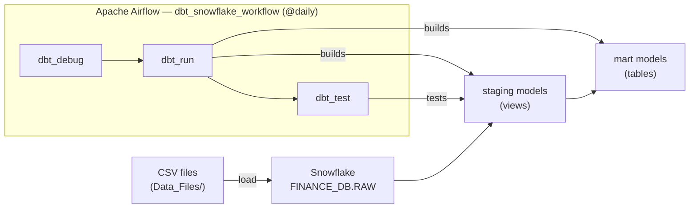

# Airflow + dbt + Snowflake Data Pipeline

A local data engineering project where **Apache Airflow** orchestrates a **dbt Core** project that runs transformations and data-quality tests in **Snowflake**.

The pipeline first checks the dbt and Snowflake configuration, then builds the dbt models, then runs the dbt tests. Raw e-commerce data (customers, orders, order items, products) is cleaned in a **staging** layer and aggregated into a **mart** fact table of revenue per order and day.

> **Status:** working end-to-end. All three tasks succeed (`dbt_debug` ✓, `dbt_run` 5/5 models ✓, `dbt_test` ✓).

---

## Table of contents

1. [Architecture](#1-architecture)
2. [Project structure](#2-project-structure)
3. [Technology stack](#3-technology-stack)
4. [Data model](#4-data-model)
5. [Airflow DAG](#5-airflow-dag)
6. [Configuration](#6-configuration)
7. [Local setup (Ubuntu / WSL2)](#7-local-setup-ubuntu--wsl2)
8. [Start Airflow](#8-start-airflow)
9. [Trigger and monitor the DAG](#9-trigger-and-monitor-the-dag)
10. [Troubleshooting](#10-troubleshooting)
11. [Security and GitHub checklist](#11-security-and-github-checklist)
12. [Current scope and future improvements](#12-current-scope-and-future-improvements)
13. [License](#13-license)

---

## 1. Architecture



| Layer | Responsibility |
|---|---|
| **Apache Airflow** | Schedules and orchestrates the workflow, and manages task dependencies, retries and execution history |
| **dbt Core** | Runs the SQL transformations and data tests defined in the dbt project |
| **Snowflake** | The target data warehouse, where dbt creates or updates the models |

> Airflow doesn't run the SQL itself. It calls dbt, and dbt runs the SQL in Snowflake.

---

## 2. Project structure

```
airflow-dbt-snowflake/
├── dags/
│   └── dbt_snowflake_dag.py          # Airflow DAG: debug → run → test
├── config/
│   ├── profiles.example.yml          # Sanitized template: copy to profiles.yml
│   └── profiles.yml                  # Your Snowflake connection (git-ignored)
├── dbt/
│   └── snowflake_data_project/
│       ├── dbt_project.yml
│       ├── Data_Files/               # Sample raw data (CSV)
│       ├── models/
│       │   ├── example/sources.yml   # Source definitions (FINANCE_DB.RAW)
│       │   ├── staging/              # stg_* models (views)
│       │   └── marts/                # fact models (tables)
│       └── tests/
│           └── snowflake_test.yml    # Data tests
├── .venv/                            # Airflow Python environment (not committed)
├── .dbt_venv/                        # dbt Python environment (not committed)
├── .airflow/                         # AIRFLOW_HOME: config, metadata DB, logs (not committed)
├── .gitignore
└── README.md
```

---

## 3. Technology stack

| Component | Version tested | Purpose |
|---|---|---|
| Python | 3.12 | Runtime |
| Apache Airflow | 3.3.2 | Workflow orchestration (LocalExecutor, SQLite metadata DB) |
| apache-airflow-providers-standard | 1.19.0 | `BashOperator` used by the DAG |
| apache-airflow-providers-snowflake | 6.17.0 | Snowflake integration (installed for future use; the DAG doesn't use it yet) |
| dbt-core | 1.13.0rc1 | SQL transformation framework |
| dbt-snowflake | 1.12.5 | dbt adapter for Snowflake |
| Snowflake | — | Cloud data warehouse (`FINANCE_DB`, warehouse `FINANCE_WH`) |
| Ubuntu 24.04 on WSL2 | — | Local development environment |

Airflow and dbt are installed in **separate virtual environments** so their dependencies don't conflict. Airflow calls the dbt executable in `.dbt_venv` through a `BashOperator`.

> Package versions can differ between environments. The versions above were tested together. Pin them when preparing a reproducible deployment.

---

## 4. Data model

### Sources: `FINANCE_DB.RAW`

| Table | Columns | Sample rows |
|---|---|---|
| `customers` | id, name, email, country | 100 |
| `orders` | id, customer_id, order_date, total_amount, status | 300 |
| `order_items` | id, order_id, product_id, quantity, unit_price | 600 |
| `products` | id, name, category, price | 10 |

The sample data is in `dbt/snowflake_data_project/Data_Files/`.

### Staging layer (materialized as **views**)

| Model | Description |
|---|---|
| `stg_customers` | Renames `id → customer_id`, `name → customer_name` |
| `stg_orders` | Renames `id → order_id`, `status → order_status` |
| `stg_order_items` | Renames `id → item_id`; adds `total_price = quantity × unit_price` |
| `stg_products` | Renames to `product_id`, `product_name`, `product_category`, `product_price` |

### Mart layer (materialized as **tables**)

| Model | Grain | Description |
|---|---|---|
| `fct_daily_order_revenue` | One row per order | `order_date`, `order_id`, and total line-item revenue (`total_price`) |

### Data tests

| Model | Column | Test |
|---|---|---|
| `stg_orders` | `order_status` | `accepted_values`: `Completed`, `Pending`, `Cancelled` |
| `stg_customers` | `customer_id` | `unique` |

---

## 5. Airflow DAG

| Property | Value |
|---|---|
| DAG ID | `dbt_snowflake_workflow` |
| Schedule | `@daily` |
| Start date / catchup | `2026-11-05` / `catchup=False` |
| Retries | 1 retry, 5-minute delay |
| Tags | `dbt`, `snowflake` |

**Execution order**

1. **`dbt_debug`**: checks the dbt project, the profile configuration and the Snowflake connection.
2. **`dbt_run`**: runs the enabled dbt models and builds them in Snowflake.
3. **`dbt_test`**: runs the tests configured in the dbt project.

```python
dbt_debug >> dbt_run >> dbt_test
```

Each task starts only after the previous one succeeds. If `dbt_debug` can't connect, no models are built.

**Portable paths.** The DAG finds the project root from its own file location, so no machine-specific paths need editing:

```python
PROJECT_DIR      = Path(__file__).resolve().parent.parent   # dags/ -> project root
DBT_PROJECT_DIR  = PROJECT_DIR / "dbt" / "snowflake_data_project"
DBT_EXECUTABLE   = PROJECT_DIR / ".dbt_venv" / "bin" / "dbt"
DBT_PROFILES_DIR = PROJECT_DIR / "config"
```

Each task runs a command like this:

```bash
"<project>/.dbt_venv/bin/dbt" run --project-dir "<project>/dbt/snowflake_data_project" --profiles-dir "<project>/config"
```

The full source is in [`dags/dbt_snowflake_dag.py`](dags/dbt_snowflake_dag.py).

---

## 6. Configuration

### dbt profile

The dbt project uses the profile named `snowflake_data_project`. It's stored in `config/profiles.yml`, and the DAG passes that directory to dbt with `--profiles-dir`.

Start from the sanitized template:

```bash
cp config/profiles.example.yml config/profiles.yml
```

```yaml
snowflake_data_project:
  target: dev
  outputs:
    dev:
      type: snowflake
      account: <orgname-accountname>        # e.g. ABCDEFG-XY12345
      user: <dbt_user>
      password: "{{ env_var('SNOWFLAKE_PASSWORD') }}"
      role: <role>
      database: FINANCE_DB
      schema: RAW
      warehouse: FINANCE_WH
      threads: 4
```

The **password is never stored in the file**. dbt reads it from the `SNOWFLAKE_PASSWORD` environment variable. If you'd rather not keep the account and user in the file either, use `"{{ env_var('SNOWFLAKE_ACCOUNT') }}"` and `"{{ env_var('SNOWFLAKE_USER') }}"` and export those variables too.

### Setting the password

To enter it without it showing on screen or being saved in shell history:

```bash
read -rsp "Enter Snowflake password: " SNOWFLAKE_PASSWORD
echo
export SNOWFLAKE_PASSWORD
```

> Set it **in the same terminal that starts Airflow**. Environment variables are copied only when a process starts. If you change the password later, export it again and **restart Airflow**.

---

## 7. Local setup (Ubuntu / WSL2)

### 7.1 Clone the repository

```bash
git clone <this-repo-url> ~/projects/airflow-dbt-snowflake
cd ~/projects/airflow-dbt-snowflake
```

### 7.2 Load the raw data into Snowflake

Create `FINANCE_DB.RAW` and load the four CSV files from `dbt/snowflake_data_project/Data_Files/` into `CUSTOMERS`, `ORDERS`, `ORDER_ITEMS` and `PRODUCTS`. You can use Snowsight's **Load Data** wizard or `PUT` + `COPY INTO`.

### 7.3 Create the Airflow environment

```bash
python3 -m venv .venv
source .venv/bin/activate

pip install "apache-airflow==3.3.2" \
  --constraint "https://raw.githubusercontent.com/apache/airflow/constraints-3.3.2/constraints-3.12.txt"

pip install "apache-airflow-providers-snowflake==6.17.0"
deactivate
```

The Airflow environment runs the scheduler and API server and parses the DAG. Keep it separate from dbt.

### 7.4 Create the dbt environment

```bash
python3 -m venv .dbt_venv
source .dbt_venv/bin/activate

pip install "dbt-core==1.13.0rc1" "dbt-snowflake==1.12.5"
deactivate
```

> These are the versions tested together. Don't assume the latest versions of dbt-core and the adapter are compatible.

### 7.5 Validate dbt and Snowflake

```bash
export SNOWFLAKE_PASSWORD   # after setting it as shown in section 6

.dbt_venv/bin/dbt debug \
  --project-dir "$PWD/dbt/snowflake_data_project" \
  --profiles-dir "$PWD/config"
```

Continue once you see `All checks passed!`. You can also run the models manually:

```bash
.dbt_venv/bin/dbt run  --project-dir dbt/snowflake_data_project --profiles-dir config
.dbt_venv/bin/dbt test --project-dir dbt/snowflake_data_project --profiles-dir config
```

---

## 8. Start Airflow

In an Ubuntu/WSL terminal:

```bash
cd ~/projects/airflow-dbt-snowflake
source .venv/bin/activate

export AIRFLOW_HOME="$PWD/.airflow"
export AIRFLOW__API__PORT=8081
export AIRFLOW__CORE__PARALLELISM=4
export AIRFLOW__CORE__DAGS_FOLDER="$PWD/dags"
```

*(Optional)* If you keep persistent Airflow API secrets in a protected file, source it:

```bash
source "$AIRFLOW_HOME/airflow-secrets.env"
```

Load the Snowflake password **into this same terminal**:

```bash
read -rsp "Enter Snowflake password: " SNOWFLAKE_PASSWORD
echo
export SNOWFLAKE_PASSWORD
```

Start Airflow and leave the terminal running:

```bash
airflow standalone
```

Open the UI at **http://localhost:8081**. The admin password is printed in the console and saved to `.airflow/simple_auth_manager_passwords.json.generated`.

> The DAG's `BashOperator` tasks run as child processes of Airflow, so they get their Snowflake credentials from the Airflow process environment.

### Non-default API port (8081)

When the API server runs on a port other than 8080, workers must be told where the execution API is. Otherwise tasks fail before they start (see [Troubleshooting](#10-troubleshooting)). Set these in `$AIRFLOW_HOME/airflow.cfg`:

```ini
[api]
base_url = http://localhost:8081

[core]
execution_api_server_url = http://localhost:8081/execution/
```

---

## 9. Trigger and monitor the DAG

1. Open the Airflow UI.
2. Find `dbt_snowflake_workflow`.
3. Enable the DAG if it's paused.
4. Trigger it manually with the ▶ (trigger) button.
5. Open the DAG run and check the task states and logs.

Expected result:

```
dbt_debug  ->  success   (All checks passed)
dbt_run    ->  success   (PASS=5: 4 staging views + 1 mart table)
dbt_test   ->  success
```

From the terminal, with the Airflow environment activated and configured:

```bash
airflow dags list
airflow dags trigger dbt_snowflake_workflow
```

Task logs are written to `.airflow/logs/dag_id=dbt_snowflake_workflow/`.


